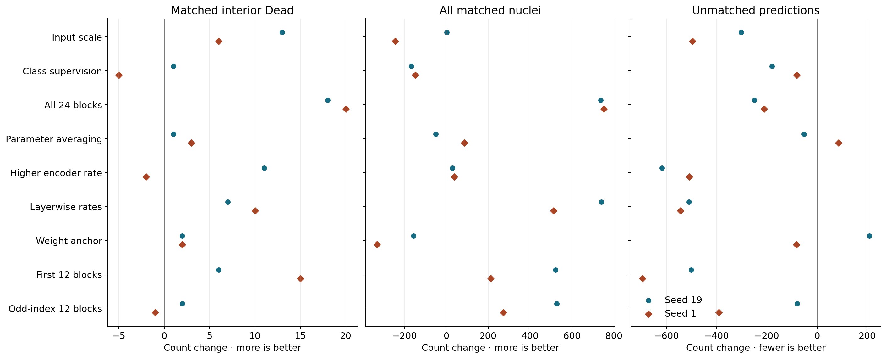
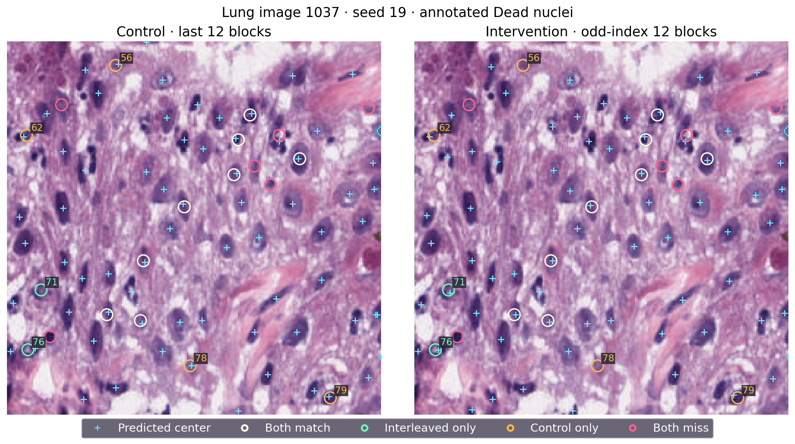
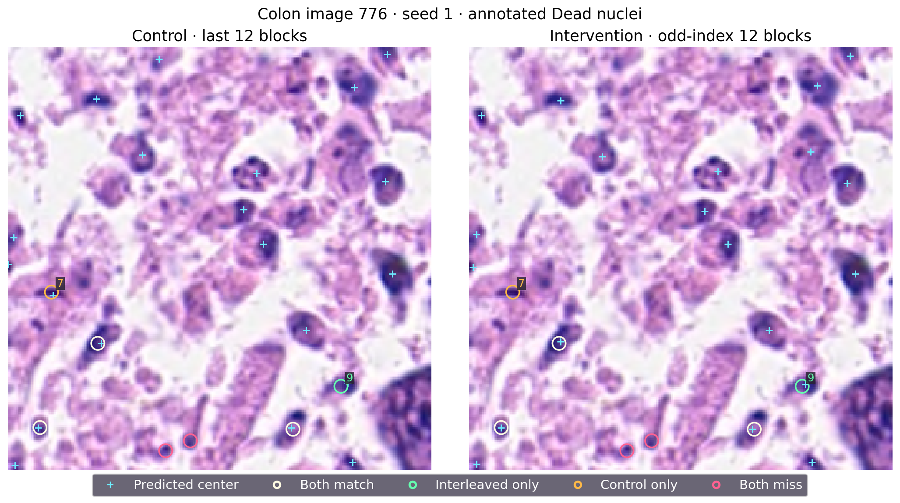

# 中文导读：为什么找到更多细胞核，仍可能遗漏同一批 Dead 核？

P28改动的是UNI编码器中哪些层接受训练：原对照训练后十二层，新模型训练编号1、3、5直到23的十二层。它们使用相同数量的可训练参数、相同图像和学习率。

总体确实改善。两种子多找到528和273个标注核，还减少80和391个额外点。但145个内部Dead核中只多找到2个、少找到1个，最终仍约一半被遗漏。这里的Dead是数据集的凋亡或坏死类别；这些数字来自522张开发评估图像上的中心匹配。

读这张图要同时看三列：找到的Dead、找到的全部核、以及额外点。全二十四层适配在两个种子都找回较多Dead；前十二层适配减少额外点尤其明显。交错层改善总体，却没有保留前两种设计的Dead收益。以前的放大输入、类别辅助监督、参数平均、提高学习率和参数约束也展示了不同取舍，所以判断不能只看最近一轮或总体精度。

青色十字表示模型预测的中心。绿圈表示新找到的Dead，橙圈表示丢失，白圈共同找到，粉圈共同遗漏。两边颜色相同是为了让你追踪同一个核。左下编号71在新模型附近出现预测点，最近距离21.02变成2.24像素；左上56附近的点则消失，2.24变成22.02。编号62和79附近仍有点，但距离超过三像素，因而没有匹配。该图最终从12个匹配变成10个：新增和丢失同时发生。

这张图两模型都是4/7，看起来没有变化。逐个看却发现编号7丢失、编号9找回：一个标注附近的输出消失，另一个预测点移入三像素范围。完整[对象表](fixed_objects.csv)保存了坐标、匹配和距离，可与图上的编号核对。另有一张结肠图拥有全部145个Dead中的49个，使总体结果明显受少量图像影响。

下一轮P29固定训练前六层和后六层，与原后十二层对照。它检验两个连续层组能否兼顾早期特征和最终输出的适配；仍保持相同参数数目、两种子、130轮、原划分及判定条件。114项针对性测试已经通过，真实V100验收和正式四任务信息见[提交记录](P29_SUBMISSION.md)。这是新设计需要回答的问题。

详细推理、九轮结果和数据来源见[中文报告](RESULTS_ZH.md)；48张原始最终样例和六张分析图已保存。原判定两种子均未通过，具体交错层配方关闭；这些成对观察仍帮助定位下一轮实验。大检查点已核对保存清单与大小，外部独立归档留待后续安排。
