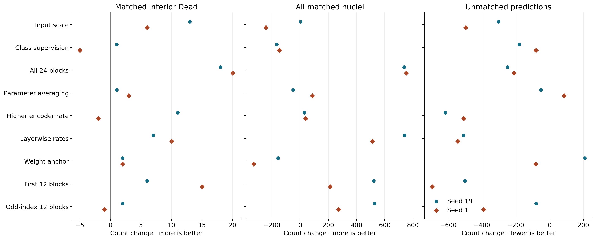
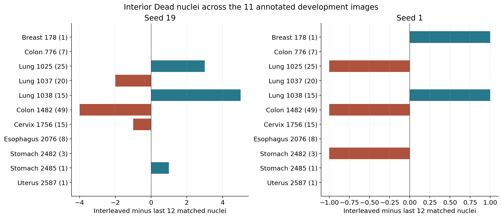
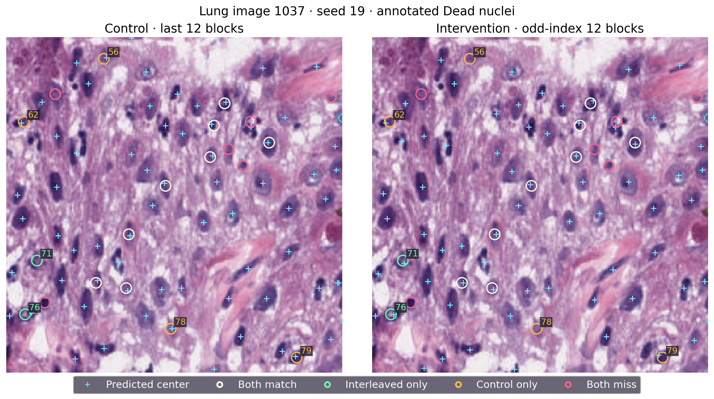
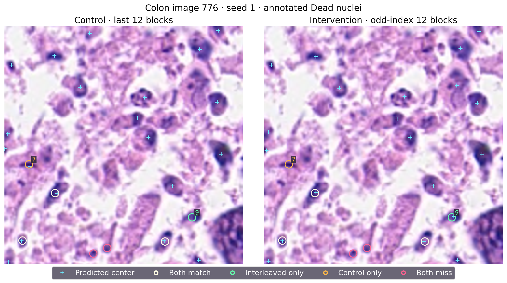

# Encoder adaptation and nucleus-center detection: P20–P28 synthesis and P29 design

## Findings

Updating twelve alternating UNI encoder blocks increased total nucleus matching in both seeds, but its effect on the rare Dead class was small and inconsistent. P28 gained 528/273 total matches and removed 80/391 unmatched predictions. Interior Dead matches changed by +2/−1. The strongest consistent Dead response in this stage remains the full-depth P22 comparison; early-only P27 updates gave a clearer precision improvement than alternating updates. The next fixed experiment tests two contiguous groups, the first six and last six blocks, at the original twelve-block parameter budget.

## Data and definitions

All P28 models trained from the same pretrained UNI weights on 2,134 PanNuke fold-1 training images and used the epoch-130 checkpoint on 522 development-evaluation images held out from that fold. Recall uses 12,250 annotated nuclei; precision uses all decoded center predictions. One-to-one matching has a three-native-pixel radius. “Interior Dead” denotes PanNuke's apoptotic/necrotic class whose annotated outline does not touch the image border: 145 objects on 11 images. The small subset has 32 objects smaller than 67 native pixels in area. Classes are used for stratification; each model emits one class-agnostic center map.

The same development split has informed successive designs. The numbers below describe paired development comparisons. Official instance PQ and three-split test reporting belong to the separate instance-segmentation protocol. Original split, seeds 19 and 1, decoder, thresholds, epoch-130 checkpoint and decision criteria are fixed. Each round has its own newly trained controls; cross-round synthesis uses paired changes. For example, the seed 19 last-12 control matched 7,264 nuclei in P27 and 7,177 in P28. These separate trajectories make contemporaneous controls essential.

## Evidence across nine rounds

| Intervention | Interior Dead matches | All matches | Unmatched predictions |
|---|---:|---:|---:|
| Input 512 (P20) | +13 / +6 | +3 / -244 | -302 / -497 |
| Class-center supervision (P21) | +1 / -5 | -168 / -148 | -180 / -81 |
| All 24 blocks (P22) | +18 / +20 | +738 / +753 | -250 / -211 |
| Parameter averaging (P23) | +1 / +3 | -51 / +87 | -52 / +85 |
| Higher late-block rate (P24) | +11 / -2 | +29 / +38 | -618 / -509 |
| All-block layerwise rates (P25) | +7 / +10 | +741 / +512 | -510 / -544 |
| Pretrained-weight anchor (P26) | +2 / +2 | -157 / -331 | +208 / -82 |
| First 12 blocks (P27) | +6 / +15 | +521 / +213 | -502 / -696 |
| Odd-index 12 blocks (P28) | +2 / -1 | +528 / +273 | -80 / -391 |

Each cell lists seeds 19 and 1. More matched nuclei and fewer unmatched predictions are favorable. These endpoints capture different behavior. Upscaling P20 found 13/6 more Dead nuclei but did not improve broad coverage consistently; its training cost was approximately4.3 times its controls. P21's auxiliary class supervision reduced both extra predictions and true matches, illustrating how fewer predictions can conceal loss of useful centers. P23's exponential parameter average made relatively small changes, with mixed broad coverage. P24's higher late-block learning rate removed 618/509 extra points but its Dead gains switched sign (+11/−2).

P22's full-depth adaptation is the strongest consistent Dead comparison in this table: +18/+20 Dead and +738/+753 total matches, alongside fewer extra points. Its final Dead recall 58.62%/56.55% and precision 72.84%/73.36% explain why it remains a useful developmental observation rather than an accepted recipe. P25's all-block layerwise rates improved total matching and reduced extra predictions more strongly, but added only7/10 Dead matches. In that round lung gained 9/8 while colon lost 7/6: aggregate improvement did not make rare-class tissue behavior uniform.

P26's fixed weight anchor added two Dead matches per seed while broad matches fell 157/331. Constraining weight movement therefore did not reproduce the beneficial full-depth response. P27 updated the first twelve blocks at the same trainable encoder capacity as the last twelve control. It added6/15 Dead and521/213 total matches while removing502/696 unmatched points. Training recall fell to 88.80%/87.82%; the stronger development response occurred with less complete training-set coverage. P28 addresses a different allocation: alternate blocks1,3,…,23. It retains late trainable blocks and restores training recall to 96.32%/96.31%, yet its rare-class benefit is weaker. Together these comparisons show that neither trainable count nor lower training coverage alone explains the Dead improvements. Update location is an experimentally relevant variable; a representation-level causal explanation remains to be measured.

## P28 measurements and cost

| Seed and allocation | Interior Dead | Small Dead | All matched | Precision | Unmatched |
|---|---:|---:|---:|---:|---:|
| 19, last 12 | 68/145 | 7/32 | 7177/12,250 | 69.23% | 3190 |
| 19, odd-index 12 | 70/145 | 9/32 | 7705/12,250 | 71.24% | 3110 |
| 1, last 12 | 72/145 | 10/32 | 7361/12,250 | 69.07% | 3296 |
| 1, odd-index 12 | 71/145 | 9/32 | 7634/12,250 | 72.44% | 2905 |

Total recall rose4.31/2.23 percentage points, and precision rose2.01/3.36 points. Seed19 emitted448 more predictions, matching528 more nuclei; seed 1 emitted118 fewer predictions while matching273 more. The first case primarily improves the usefulness of emitted points; the second improves both their usefulness and count. Small Dead matches changed7→9 and10→9.

Training-set recall changed97.91%→96.32% and97.89%→96.31%. Final focal loss changed0.05339→0.08767 and0.05474→0.08310. Pure training took 4.009/4.020 hours for controls and4.781/4.757 hours for alternate blocks, an increase of 19.27%/18.33%. Peak allocated GPU memory was 4.05 versus 4.78 GiB. Scheduler elapsed time totaled18:19:46 (18.3294 GPUh) across the four jobs, including startup, checkpointing and preservation. Pure training time and scheduler accounting answer different cost questions.

The original image bootstrap was independently recomputed against the saved admission function. Dead recall gains were 1.38/−0.69 percentage points, with95% intervals [−6.29,+13.27]/[−2.54,+2.34] points. Final Dead recall 48.28%/48.97%, gain and lower-bound requirements, and final precision 71.24%/72.44% were below the fixed criteria. Both seeds failed the full conjunction; the exact odd-index recipe closes. No gate or threshold was adjusted after the result.

## Tissue and object changes

Lung's aggregate change was+6/0; colon changed−4/−1. Seed19 lung image 1038 added five matches, while colon image 1482 lost four. The colon image contains49 of145 interior Dead objects (33.79% of support). Removing this image descriptively changes seed 19's gain to 6/96=6.25%; removing lung1038 changes it to −3/130=−2.31%. Seed1 leave-one-image changes range from−1.54% to0.00%. These sensitivity calculations quantify concentration while retaining all11 images in the actual decision.

The pre-fixed eight examples contain53 interior Dead objects. Seed19 retained 26, gained 7, lost 6 and missed 14 in both arms. Seed1 retained 28, gained 5, lost 5 and missed 15. Their net changes are+1/0, compared with+2/−1 in the complete 522-image evaluation. Fixed examples explain individual events; the complete image set determines the aggregate result.

Cyan crosses are all decoded predictions. White rings identify Dead objects matched by both models, green rings those matched only by alternating updates, orange rings those matched only by control, and pink rings misses in both. Labels index the preserved GT list in [fixed_objects.csv](fixed_objects.csv); coordinates use row,column.

In lung image 1037 seed 19, matches changed12→10: two objects gained a match and four lost one. Object 71 at(170,23), in the lower-left tissue, changed nearest-point distance21.02→2.24 pixels. Object 76 at(211,14) changed5.10→2.00. Conversely, upper-left object 56 at(16,74) changed2.24→22.02, and lower object 78 at(222,125) changed1.00→22.36; the intervention has no nearby decoded output at those annotations. Object 62 at(64,13) changed2.24→3.16 and object 79 at(244,221) changed1.41→3.61. These latter losses arise at the three-pixel matching boundary: visually nearby points can remain outside the assigned radius.

Colon image 776 stayed at4/7 Dead matches in both seeds, with one gained and one lost object. Object 7 at(148,26) lost its nearby prediction in both seeds: nearest distance became28.30 pixels, from2.83/2.24. Object 9 at(205,201) gained a match at(204,203), distance2.24, from control distances3.16/4.47. A constant image count therefore conceals substitution of which nuclei are found. The loss at object7 concerns absence of a nearby decoded point; the gain at object9 involves a point entering the match neighborhood.

The dark nuclear outlines, stain gradients and crowded tissue in the panels provide spatial context. Decoded coordinates establish point disappearance and displacement. The saved scalar coordinates do not contain unfiltered probability maps; attribution to weak center scores, peak suppression or internal features requires a future score-map measurement. The original four-panel PNGs also preserve response previews.

## P29 frozen comparison

P29 updates blocks 0..5 and18..23 versus control blocks 12..23. Both have 151,179,264 trainable encoder parameters and 3,294,657 head parameters. Embeddings, normalization and the other blocks remain frozen; backpropagation traverses frozen middle blocks. The hypothesis is complementary adaptation of early features and final outputs through two contiguous groups. P28's alternating pattern is closed; P29 fixes a different allocation before its own training.

Four fresh C/B×seeds 19 and 1 runs retain encoder/head learning rates 1e-5/3e-4, AdamW decay .01, original 130-epoch cosine schedule, effective batch 16/microbatch 4 batches, native 256-pixel input, target sigma 1/radius 3, focal objective, original augmentation, decoder and last-checkpoint evaluation. The full original two-seed conjunction applies to B−C, including Dead recall ≥.60, gain ≥.05, positive fixed-bootstrap lower bound, precision ≥.75 and the original noninferiority/nondegeneracy conditions. No parameter menu or additional confirmation round is part of P29.

The isolated source passed 114 focused tests. The V100 validation and formal submission state, resource checks, source commit and hashes are recorded in [P29_SUBMISSION.md](P29_SUBMISSION.md). Formal resource ceiling is 48 GPU hours, four 12-hour tasks with concurrency2. Final runs will each preserve eight development and four training examples with coordinates. The current user request ends at verified formal submission; completion metrics will be checked after the jobs finish.

## Preservation and reproduction

Expanse array 55712506 completed all four runs/130 epochs with exit0:0. Verification covered 500 sealed source files and 98 small payloads, including 48 final PNGs. The result archive has 5,891,679 bytes and SHA-256 716d08022b5251f45a146b3924f73761ba0e47d17ef4bcca6169eddf0efa1110. Eight checkpoint byte counts agreed with preservation manifests; independent large-checkpoint rehashing and external archival remain outstanding. Raw small results and all 48 PNG files are retained on LM1 under ops/review_20261114/p28_files and in the local delivery.

[Machine-readable aggregates and bootstrap](p28_analysis.json), [collection verification](collection_result.json), [fixed object coordinates](fixed_objects.csv), [sensitivity summary](object_summary.json), and [paired stage table](stage_pairs.csv) accompany this report. The local source/review_2026-11-14 directory retains the analysis and plotting scripts; their LM1 copies use the same broker session and project interpreter. Published figure values were checked against these numeric records and panels were visually reviewed.
