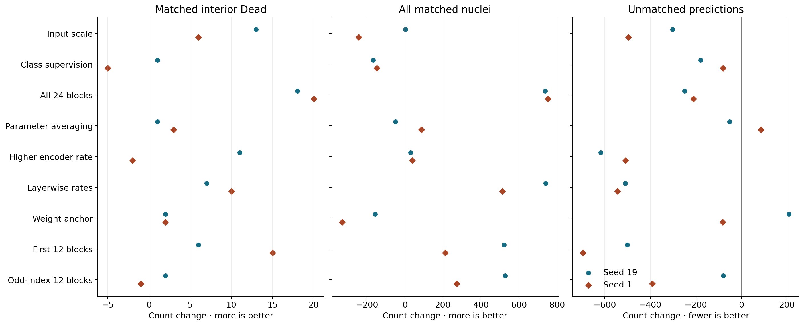
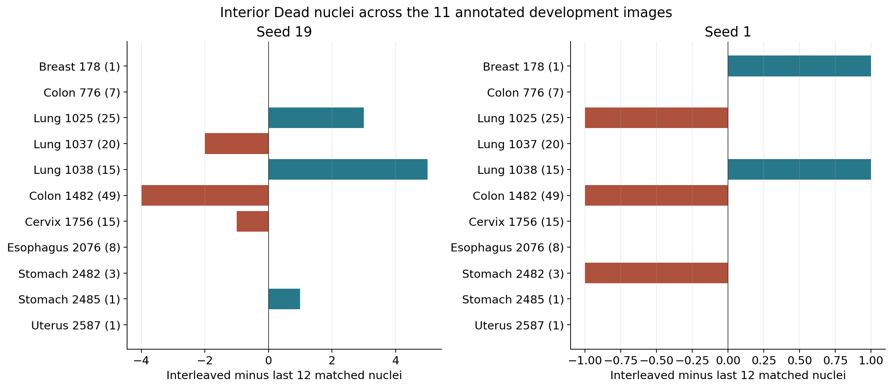
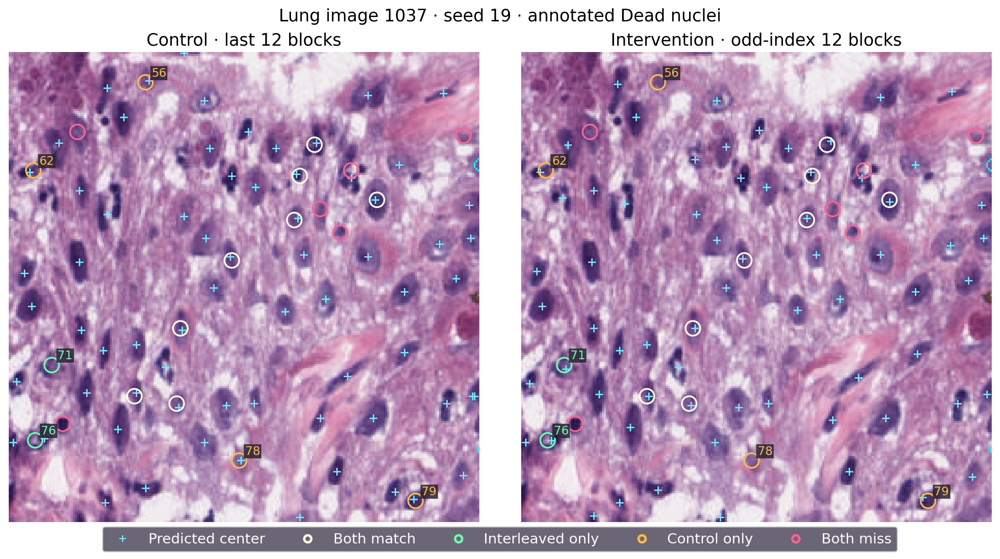
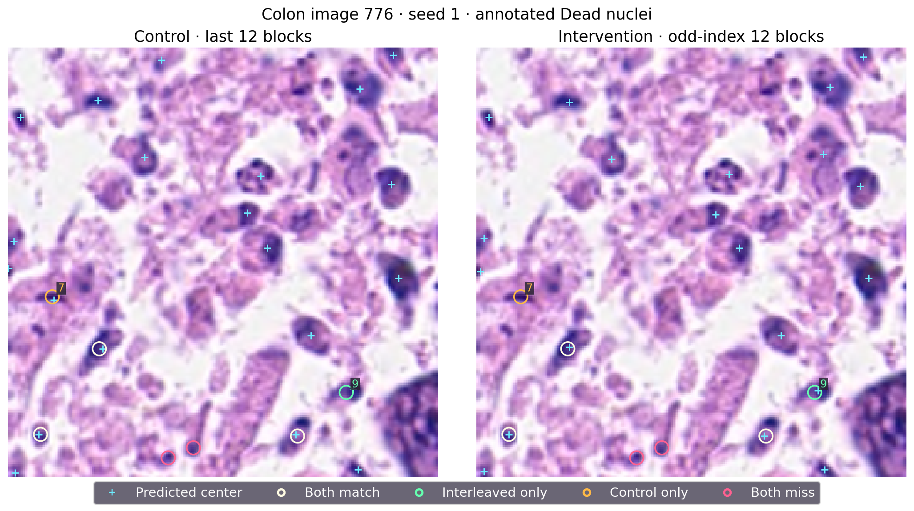

# 编码器适配位置与细胞核中心检测：P20–P28 综合分析及 P29 设计

## 主要结论与实验范围

P28 在 UNI 编码器中训练奇数编号的十二层，使总体核匹配数增加528/273，额外点减少80/391，但内部 Dead 核匹配只变化+2/−1。本阶段最稳定的 Dead 收益来自全部二十四层适配；前十二层适配对精度的改善比交错层更明显。下一轮固定检验“前六层加后六层”，在十二层的参数预算内比较两个连续层组的作用。

P28 使用 PanNuke 第一折的2,134张训练图像，在该折预先留出的522张开发评估图像上评价第130轮模型。召回率分母为12,250个标注核，精度分母为全部预测点。匹配采用三原生像素以内的一对一分配。内部 Dead 指 PanNuke 中凋亡或坏死类别、且标注轮廓不接触图像边界的对象：11张图像共145个核，其中32个面积小于67原生像素。模型输出单一中心预测图，类别仅用于结果分层。

后续设计反复参考同一开发集。这里报告的是成对开发实验；实例分割的官方 PQ 和三划分测试有独立协议。每轮重新训练自己的同种子对照，跨轮综合使用相对于本轮对照的变化。例如种子19的后十二层对照在P27匹配7,264个核，在P28匹配7,177个核；应使用同期对照分析干预效果。

## 九轮实验的证据关系

| 设置 | 内部 Dead 匹配变化 | 全部核匹配变化 | 额外点变化 |
|---|---:|---:|---:|
| 512 像素输入（P20） | +13 / +6 | +3 / -244 | -302 / -497 |
| 类别中心辅助监督（P21） | +1 / -5 | -168 / -148 | -180 / -81 |
| 全部 24 层适配（P22） | +18 / +20 | +738 / +753 | -250 / -211 |
| 参数指数平均（P23） | +1 / +3 | -51 / +87 | -52 / +85 |
| 后 12 层提高学习率（P24） | +11 / -2 | +29 / +38 | -618 / -509 |
| 全层分层学习率（P25） | +7 / +10 | +741 / +512 | -510 / -544 |
| 预训练参数约束（P26） | +2 / +2 | -157 / -331 | +208 / -82 |
| 前 12 层适配（P27） | +6 / +15 | +521 / +213 | -502 / -696 |
| 奇数编号 12 层适配（P28） | +2 / -1 | +528 / +273 | -80 / -391 |

每格依次为种子19和1。前两列越大表示找到更多标注核，最后一列越小表示额外点更少。三者需要一起分析。P20放大输入找回13/6个Dead核，总体覆盖改善不稳定，纯训练耗时约为原来的4.3倍。P21的类别辅助监督同时减少额外点与真正匹配，说明预测更少也可能丢失有效中心。P23参数平均的变化较小、方向不统一。P24提高后十二层学习率，额外点减少618/509，但Dead收益为+11/−2，跨种子不一致。

P22全部二十四层适配是本表Dead收益最稳定的实验：增加18/20个内部Dead和738/753个总体匹配，同时减少额外点。最终Dead召回58.62%/56.55%、精度72.84%/73.36%，仍低于固定接受标准。P25全层分层学习率进一步改善总体匹配和额外点，但Dead只增加7/10；其中肺组织增加9/8、结肠减少7/6，说明总体改善没有消除组织间差异。

P26向预训练参数施加固定约束，Dead每种子增加2个，总体匹配反而减少157/331。限制参数变化未重现全层适配的收益。P27在相同可训练参数数目下改为前十二层，Dead增加6/15，总体匹配增加521/213，额外点减少502/696；训练召回降至88.80%/87.82%。它在训练中心覆盖较低时改善了开发集。P28的交错层保留较后层的适配，训练召回恢复到96.32%/96.31%，但Dead收益变弱。因此，可训练参数数目和训练覆盖降低都不足以单独解释这些改善；层的位置具有实验意义，内部表征机制仍待直接测量。

## P28 数值与计算代价

| 种子、设置 | 内部 Dead | 小型 Dead | 全部匹配 | 精度 | 额外点 |
|---|---:|---:|---:|---:|---:|
| 19, 后 12 层 | 68/145 | 7/32 | 7177/12,250 | 69.23% | 3190 |
| 19, 奇数编号 12 层 | 70/145 | 9/32 | 7705/12,250 | 71.24% | 3110 |
| 1, 后 12 层 | 72/145 | 10/32 | 7361/12,250 | 69.07% | 3296 |
| 1, 奇数编号 12 层 | 71/145 | 9/32 | 7634/12,250 | 72.44% | 2905 |

总体召回增加4.31/2.23个百分点，精度增加2.01/3.36个百分点。种子19预测点增加448而匹配增加528，说明新增点与既有点合计更有效；种子1预测点减少118而匹配增加273，说明更少的点找到更多核。小型Dead分别7→9、10→9。

训练召回97.91%→96.32%、97.89%→96.31%，最终中心检测损失0.05339→0.08767、0.05474→0.08310。对照纯训练4.009/4.020小时，交错层4.781/4.757小时，增加19.27%/18.33%；峰值已分配显存4.05→4.78GiB。四任务调度总耗时18:19:46，即18.3294GPU小时，另包含启动、检查点和保存时间。

原有图像级bootstrap与保存的判定函数已分别复算并一致。Dead召回变化为+1.38/−0.69个百分点，95%区间为[−6.29,+13.27]/[−2.54,+2.34]。最终Dead召回48.28%/48.97%，提升幅度、区间下界以及精度71.24%/72.44%均未满足固定条件，两种子完整判定均失败，关闭具体奇数层配方。结果出现后未修改阈值或接受条件。

## 组织分布与逐对象解释

肺组织合计变化+6/0，结肠−4/−1。种子19肺组织图1038增加5个，而结肠图1482减少4个。结肠图1482拥有49/145，即33.79%的内部Dead标注，贡献集中。仅作敏感性分析时，删除该图会使种子19变化成为6/96=6.25%；删除肺组织图1038则为−3/130=−2.31%。种子1逐张删除后的范围为−1.54%至0.00%。实际判定保留全部十一张图，以上计算用于量化图像集中程度。

原先固定的八张样例包含53个内部Dead核。种子19两臂共同找到26个、交错层新增7个、丢失6个、共同遗漏14个；种子1为28、5、5、15。固定样例净变化+1/0，全体评估为+2/−1。样例用于解释具体位置的变化，全体522张图决定指标。

青色十字是全部预测点；白圈为两臂都匹配的Dead核，绿圈为交错层新增，橙圈为对照找到而交错层丢失，粉圈为共同遗漏。编号对应保存的GT列表位置，坐标采用行、列，见[对象表](fixed_objects.csv)。同色圆圈在两面板中表示同一对象的成对结果。

肺组织图1037种子19从12个匹配变为10个，新增2个、丢失4个。左下对象71位于(170,23)，最近预测点距离21.02→2.24像素；对象76位于(211,14)，5.10→2.00。左上对象56位于(16,74)，2.24→22.02；靠下对象78位于(222,125)，1.00→22.36，交错层在这些标注附近没有输出点。对象62位于(64,13)，2.24→3.16；对象79位于(244,221)，1.41→3.61，这两次丢失位于三像素匹配边界，肉眼看似接近的点仍可超出匹配半径。

结肠图776在两种子均保持4/7个匹配，却都新增一个、丢失一个。对象7位于(148,26)，对照距离2.83/2.24像素，交错层均为28.30，附近的输出点消失。对象9位于(205,201)，交错层预测(204,203)，距离2.24；对照距离为3.16/4.47。总体相同的单图数值因此隐藏了“丢失一个远离输出的核、找回一个进入匹配邻域的核”的交换。

图中的深染轮廓、染色梯度与密集组织提供位置背景。坐标直接证明输出点的消失或偏移；要进一步区分标注附近预测分数不足、局部峰值偏移和筛选抑制，需要保存未筛选概率图。原始四面板PNG同时保留了中心响应预览。这些观察为后续机制测量提供对象位置，不直接指定内部表征原因。

## 下一轮设计与可追溯性

P29干预训练编号0..5及18..23，对照训练12..23。两臂均有151,179,264个可训练编码器参数及3,294,657个检测头参数；嵌入、归一化和其余层冻结，梯度经过冻结的中间层。假设是两个连续层组能同时支持早期特征与末端输出适配。这是在P28后选择并于新训练前固定的开发实验。

四次新训练为C/B×种子19/1，保持130轮、最后检查点、编码器/检测头学习率1e-5/3e-4、AdamW衰减.01、原余弦调度、有效批16/实际批4、256输入、中心目标sigma1/半径3、原中心损失、增强、解码器及数据划分。原双种子完整判定继续用于B−C，包括Dead召回≥.60、提升≥.05、固定bootstrap下界>0、精度≥.75及原非劣化/非退化条件。本轮没有参数菜单或额外确认实验。

隔离工作树114项针对性检查已通过。真实V100验收、正式提交状态、科学代码版本、源文件封存与资源信息见[P29提交记录](P29_SUBMISSION.md)。正式预算上限48GPU小时，四个12小时任务、并发2；最终每跑保留八张开发样例、四张训练样例及坐标。本次任务以正式提交核验为终点，完成后再复核训练与评估。

Expanse数组55712506四跑均130轮完成、退出0:0。已核验500个封存源码文件、98个小型产物，其中48张最终PNG。结果压缩包5,891,679字节、SHA256为716d08022b5251f45a146b3924f73761ba0e47d17ef4bcca6169eddf0efa1110。八个大检查点大小与原清单一致，独立重哈希及外部归档尚待完成。全部原始图片与小结果在LM1 ops/review_20261114/p28_files及本地交付保存。随文提供[完整数值](p28_analysis.json)、[回收核验](collection_result.json)、[对象坐标](fixed_objects.csv)、[敏感性分析](object_summary.json)与[阶段成对表](stage_pairs.csv)，图表已核数并目视检查。
