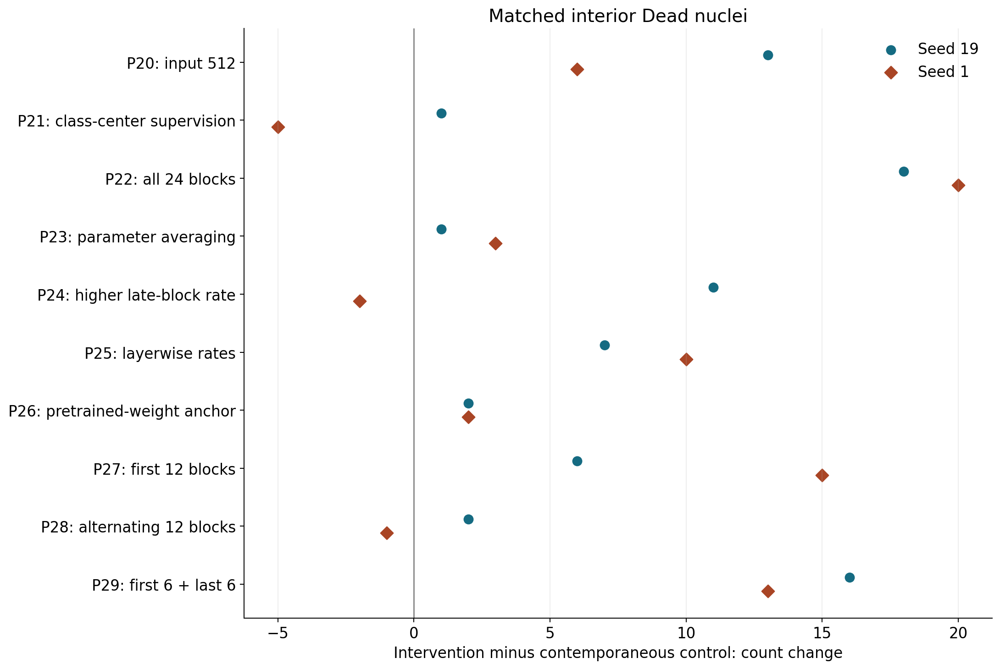
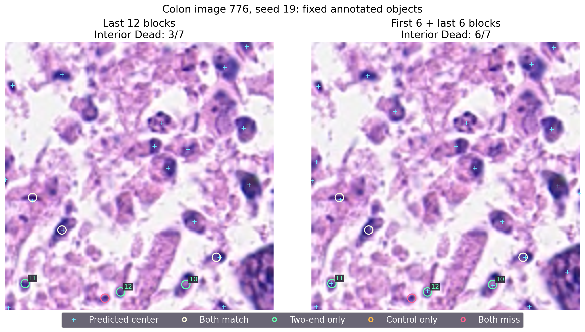
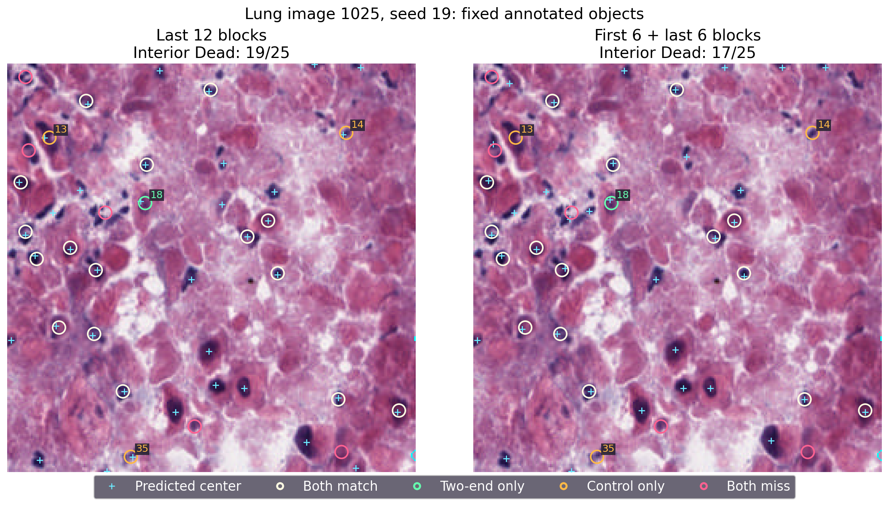
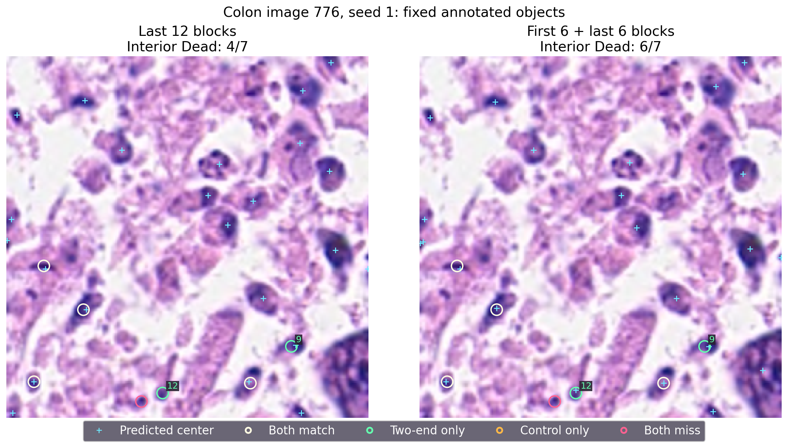

# 中文导读：更新哪些层，模型能多找到哪些核？

本阶段把模型的训练改变拆成多个固定对照：扩大输入、额外类别监督、平均参数、限制参数移动，以及更新编码器不同位置的层。每项都重新训练同轮对照，再统计预测中心与标注核的一对一匹配。详细数据和协议见 [中文分析](RESULTS_ZH.md)。

最值得关注的是三条证据。更新全部 24 层时，两个种子都多找到了较多 Dead 核；只更新前十二层时，模型减少了许多额外预测；把十二层交错分布到整个编码器，虽然提高了总体匹配，Dead 改善却很小。这说明“多训练一些参数”与“在哪些位置更新”需要分别比较，训练集上找到更多核也不能单独预测开发集的改善。

最新 P29 更新前六层和后六层。种子 19/1 分别多找到 16/13 个内部 Dead 核，召回从 44.83%/46.21% 提高到 55.86%/55.17%；总匹配增加 283/165，额外点减少 65/64。两个种子的配对区间均为正，最终 Dead 召回和精度仍低于原定要求，原双种子完整条件未通过。下一轮固定比较中间十二层与最后十二层，补上连续层位置的对照。

先看结肠图像下方编号 10、11、12 的绿色圆圈。右图三个标注附近都有青色预测十字，左图附近没有预测。三个最近点距离从约 41、28、81 像素降至 1 像素，目标匹配从 3 个增加到 6 个。这是具体核被找回的可核查例子。

再看肺组织图像 1025：它整体少找到两个 Dead 核。新增一个匹配的同时，三个原来有匹配的核失去了附近预测，其中一个面积只有 31 像素。改善不是每张组织图都同方向。详细报告逐一给出这些核的坐标和距离，并讨论“附近新增输出”和“点移动跨越三像素匹配半径”两种可观察事件。

固定八张样例中的 Dead 核净增加两个，完整 522 张开发评估图像净增加 16 个。样例用于解释具体发生了什么，完整数据用于确定改善幅度。肺组织图像 1038 和食管图像 2076 贡献了 10 个净增加量；逐一去掉一张阳性图像的敏感性分析仍保持正方向。结果图、原始坐标和数值表都已保存，可以复查图中的每个变化。

本阶段使用反复分析的第 1 折开发数据，采用最后检查点和固定中心匹配规则。后续机制分析还需要模型概率图或隐层测量，才能分清点的变化来自分数、峰值筛选还是表征改变。

两个种子是否找回了同一个核，也可以直接复查：结肠对象 12 位于（238，110），两个实验模型都在它附近新增有效预测。肺组织图像 1025 的对象 35 则在两个种子中都丢失了匹配。另一张肺组织图像 1037 在种子 1 的匹配总数不变，却交换了两个新增和两个丢失。详细报告把重复恢复、重复丢失和局部交换分开解释，而不只比较图像总数。

四个模型的训练与开发评估已完成。实验种子 1 的作业在保存阶段超时后，CPU 恢复作业完整保存了两个检查点和 12 张最终图片，并核验源文件与目标回读哈希；完整交付包含 48 张最终模型结果图和 13 张分析图。下一轮 P30 已冻结，正式提交的实际状态见 [P30 记录](P30_SUBMISSION.md)。
