# Encoder update location and nucleus-center detection: P20–P29

P29 recovered 16/13 additional interior Dead nuclei in seeds 19/1 at the original twelve-block update budget. Total matches increased by 283/165 and unmatched predictions decreased by 65/64. Both paired image-bootstrap intervals are positive. Final Dead recall and precision remain below the original absolute criteria. All four models completed 130 epochs and development evaluation. The last scheduler task reached its time limit during preservation; a subsequent CPU job preserved and verified both experimental seed-1 checkpoints and all result images. Across this stage, updating encoder representations has produced more consistent gains than the tested auxiliary supervision, parameter averaging and weight constraint. The effect depends on which layers are updated and which tissue images are considered.

## Data, matching and study sequence

Each round trains fresh controls and interventions from the same pretrained UNI weights on 2,134 PanNuke fold-1 training images. The epoch-130 checkpoint is evaluated on the same 522 development images held out from that fold. Their 12,250 annotated nuclei define overall recall. Precision uses every decoded center, including unmatched predictions. One-to-one center matching uses a three-native-pixel radius. The single output map predicts nucleus centers without class labels; classes stratify the measured detections.

Interior Dead means the apoptotic/necrotic category with an annotated outline clear of the image border: 145 nuclei on 11 images. The small-object subset contains 32 objects with native area below 67 pixels. All comparisons retain seeds 19/1, the original split, decoding, last-checkpoint rule and thresholds. Successive designs reuse this development cohort. The tables describe within-round paired changes; official instance-segmentation PQ and independent three-split evaluation have their own protocol.

P30 was frozen before complete P29 seed-1 results, using P20–P28 evidence and P29 execution progress. It compares blocks 6–17 with blocks 12–23 at equal trainable capacity. P29 remains on its original allocation. The P30 acceptance and formal job receipt are documented separately in [P30_SUBMISSION.md](P30_SUBMISSION.md).

## What the ten comparisons have established

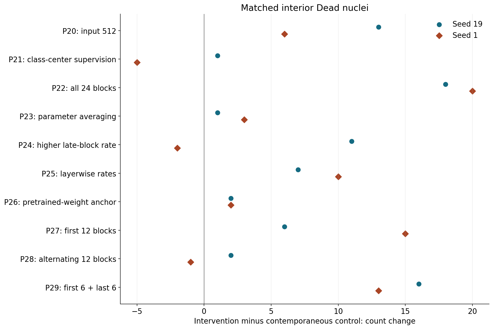

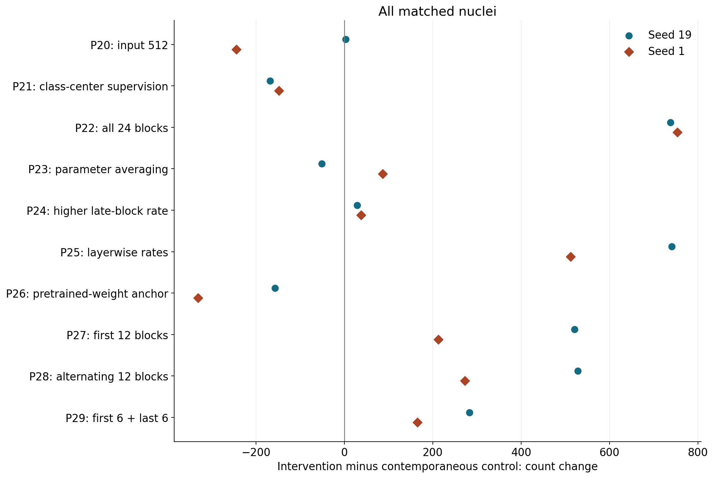

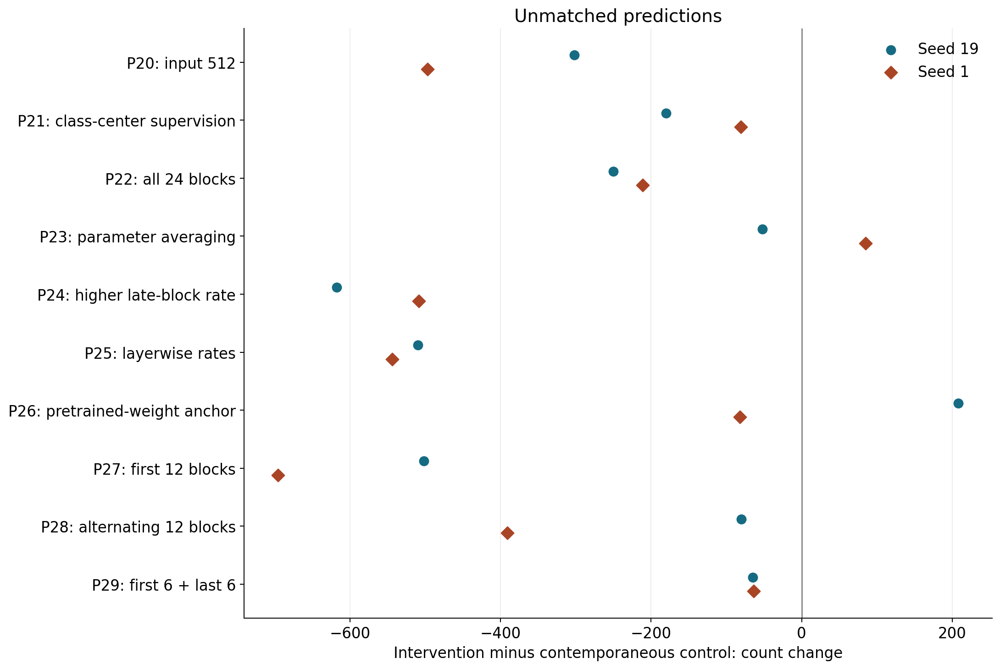

| Tested intervention | Interior Dead matches, seeds 19 / 1 | All matches | Unmatched predictions |
|---|---:|---:|---:|
| Input 512, P20 | +13 / +6 | +3 / −244 | −302 / −497 |
| Class-center supervision, P21 | +1 / −5 | −168 / −148 | −180 / −81 |
| All 24 encoder blocks, P22 | +18 / +20 | +738 / +753 | −250 / −211 |
| Parameter averaging, P23 | +1 / +3 | −51 / +87 | −52 / +85 |
| Higher late-block rate, P24 | +11 / −2 | +29 / +38 | −618 / −509 |
| All-block layerwise rates, P25 | +7 / +10 | +741 / +512 | −510 / −544 |
| Pretrained-weight constraint, P26 | +2 / +2 | −157 / −331 | +208 / −82 |
| First 12 blocks, P27 | +6 / +15 | +521 / +213 | −502 / −696 |
| Alternating 12 blocks, P28 | +2 / −1 | +528 / +273 | −80 / −391 |
| First 6 + last 6 blocks, P29 | +16 / +13 | +283 / +165 | −65 / −64 |

P20 found additional Dead nuclei through larger input images, but broad coverage was inconsistent and training cost rose approximately 4.3-fold. The spatial scale intervention therefore addresses a different tradeoff from changing encoder update location. P21 reduced predictions and true matches together. Its extra class-center targets did not improve rare-object transfer under the tested fixed objective. P23's parameter average changed few Dead matches and had mixed effects on total coverage. P24 improved precision by removing many unmatched points, but its rare-class gain reversed across seeds. These outcomes separate prediction reduction from recovery of missing nuclei.

P22 produced the strongest consistent rare-class change: +18/+20 interior Dead matches, with +738/+753 total matches and fewer unmatched predictions. Final Dead recall was 58.62%/56.55% and precision 72.84%/73.36%. Updating the full encoder improved the observed detections while leaving the original absolute requirements unmet. P25 also improved broad coverage and precision, but smaller Dead gains (+7/+10) came with tissue differences: lung gained 9/8 and colon lost 7/6. More total matches therefore do not imply consistent recovery of the target class across tissues.

P26's pretrained-weight constraint reduced broad matching by 157/331 while adding two Dead matches per seed. Retaining parameters closer to their initialization did not reproduce the full-depth response. P27, with the same trainable parameter count as the late-block control, gained 6/15 Dead matches and removed 502/696 unmatched predictions. Its training recall dropped to 88.80%/87.82%. P28 restored training recall to about 96.3% by distributing updates across alternating layers, while its rare-class change weakened to +2/−1. P29 seed 19 occupies another point in this comparison: training recall is 95.47% and rare-object recovery rises by 16. These experiments establish update location as a useful experimental variable. Training recall, trainable count and distributed depth each leave part of the observed variation unexplained. The representation mechanism remains a hypothesis.

## P29 seed 19: coverage, precision and cost

| Allocation | Interior Dead | Small Dead | All matched | Recall | Precision | Unmatched |
|---|---:|---:|---:|---:|---:|---:|
| Last 12 blocks | 65/145 | 7/32 | 7,257/12,250 | 59.24% | 69.73% | 3,150 |
| First 6 + last 6 | 81/145 | 11/32 | 7,540/12,250 | 61.55% | 70.96% | 3,085 |

The intervention emitted 218 more points while finding 283 more nuclei. This combination reflects more useful predictions rather than a simple increase in output count. Interior Dead recall rose 11.0345 percentage points, with the unchanged 1,000-draw tissue-stratified bootstrap interval [+3.0457,+27.9570] points. Overall recall rose 2.3102 points and precision 1.2328 points. The original seed-level conjunction fails the absolute Dead recall (.60) and precision (.75) clauses; all other seed-19 clauses pass. The seed-1 comparison independently improves Dead recall by 8.9655 percentage points and also fails the same two absolute clauses.

Training recall changed 97.51%→95.47% and training Dead coverage 630/656→607/656. Pure training took 4.0130 versus 4.8652 hours, a 21.24% increase. Peak allocated GPU memory was 4.05 versus 4.84 GiB. Completed seed-19 scheduler elapsed time was 4:13:24 plus 5:00:21, including startup, evaluation and preservation. These measurements price the twelve-block intervention without substituting training fit for development performance.

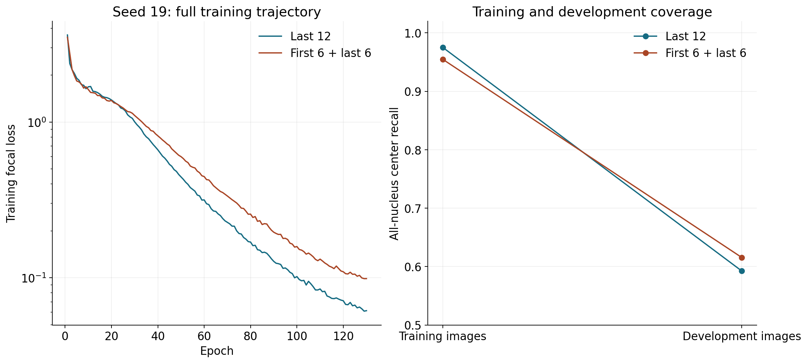

## Tissue distribution and sensitivity

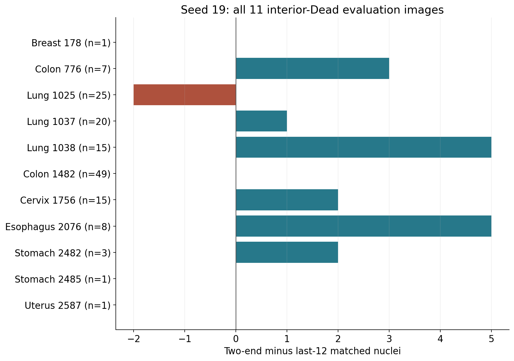

Six images gained matches, one lost matches and four were unchanged. Lung changed +4, colon +3, cervix +2, esophagus +5 and stomach +2; breast and uterus were unchanged. Lung image 1038 and esophagus image 2076 each gained five, together accounting for 10/16 net gains. Lung image 1025 lost two despite aggregate lung improvement. Colon image 1482 contains 49/145 target objects and stays at 13 matches in both arms, leaving 36 unmatched target objects in that image.

Removing one Dead-positive image at a time, solely as a sensitivity calculation, leaves gains between 8.03% and 16.67%. Every such gain remains positive. The observed seed-19 sign consequently survives omission of any one contributing image; the full original decision still includes all eleven images. A tissue with one positive image offers limited evidence for between-image consistency within that tissue.

## Fixed images: which annotated nuclei changed

The pre-fixed eight evaluation examples contain 53 interior Dead nuclei. Seed 19 retained 30, gained 6, lost 4 and missed 13 in both arms. Their net change is +2, versus +16 across all 522 evaluation images. Object indices and row,column coordinates are retained in [fixed_objects.csv](fixed_objects.csv). Cyan crosses show all predictions; shared white, green, orange and pink rings respectively identify retained, gained, lost and jointly missed target objects.

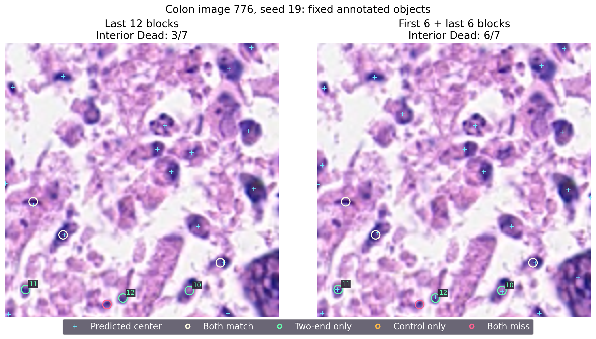

Colon image 776 changes from 3/7 to 6/7 target matches. Three gained objects lie in the lower tissue strip: object 10 at (231,172), object 11 at (230,19), and object 12 at (238,110). Their nearest decoded-point distances change 41.23→1.00, 28.02→1.00 and 80.66→1.00 pixels. The right panel places predictions close to all three annotations; the control has no decoded point in their immediate neighborhoods. Their visible size and pale appearance vary, and object 12 has area 104 pixels. This is recovery beyond the smallest predefined size bin.

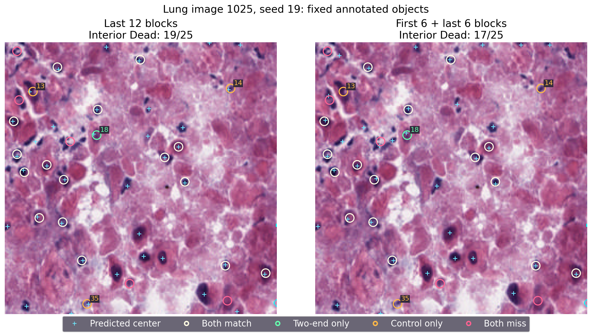

Lung image 1025 changes from 19/25 to 17/25. Object 18 at (87,86) gains a match as its nearest point moves from 3.16 to 2.24 pixels, crossing the fixed three-pixel matching boundary. Objects 13 at (46,26), 14 at (43,212), and 35 at (246,77) lose matches, with nearest distances 3.00→14.56, 2.24→41.77 and 1.00→18.36. Object 14 has area 31 pixels and is visibly small. The intervention removes useful outputs around these annotations while recovering another object. The full tissue aggregate cannot reveal this exchange.

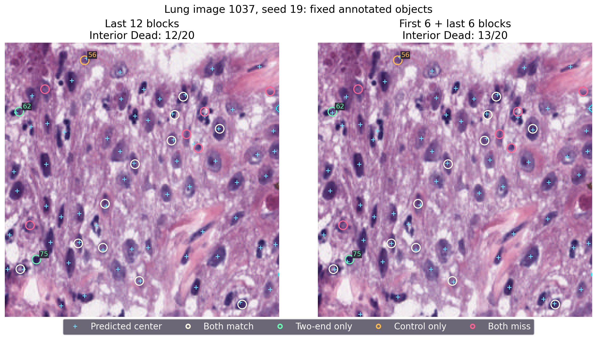

Lung image 1037 changes from 12/20 to 13/20. Object 62 at (64,13) gains a match as nearest distance falls 3.16→1.00; object 75 at (202,29), area 44 pixels, changes 15.00→2.83. Object 56 at (16,74) loses its match after a nearby point shifts from 2.83 to 3.61 pixels. The latter event is a displacement across the matching radius; the former small-object gain places a prediction in a previously uncovered neighborhood.

Coordinates establish appearance, disappearance and displacement of decoded points. Image intensity and tissue context make these events visible. Attribution to center-score strength, peak suppression or hidden encoder features requires probability maps or intermediate measurements; this collection stores original images, annotated centers, decoded points and one-to-one assignments.

## Seed 1 and consistency across seeds

| Seed / allocation | Interior Dead | Small Dead | All matched | Recall | Precision | Unmatched |
|---|---:|---:|---:|---:|---:|---:|
| 1 / last 12 | 67/145 | 7/32 | 7,329/12,250 | 59.83% | 69.25% | 3,255 |
| 1 / first 6 + last 6 | 80/145 | 11/32 | 7,494/12,250 | 61.18% | 70.14% | 3,191 |

Seed 1 adds 13 target matches, with the unchanged tissue-stratified 95% bootstrap interval [+3.1250,+20.4082] percentage points. It emits 101 more predictions and finds 165 more nuclei. Both seeds improve overall recall, precision and small-Dead coverage, while training coverage falls. The two-seed conjunction remains false because neither final Dead recall nor precision reaches the original .60/.75 criteria. The observed means of the within-seed changes are 10.0 percentage points for Dead recall, 1.83 points for all-nucleus recall and 1.06 points for precision; the same images occur in both seeds, so these means summarize the paired outcomes without doubling the image sample size.

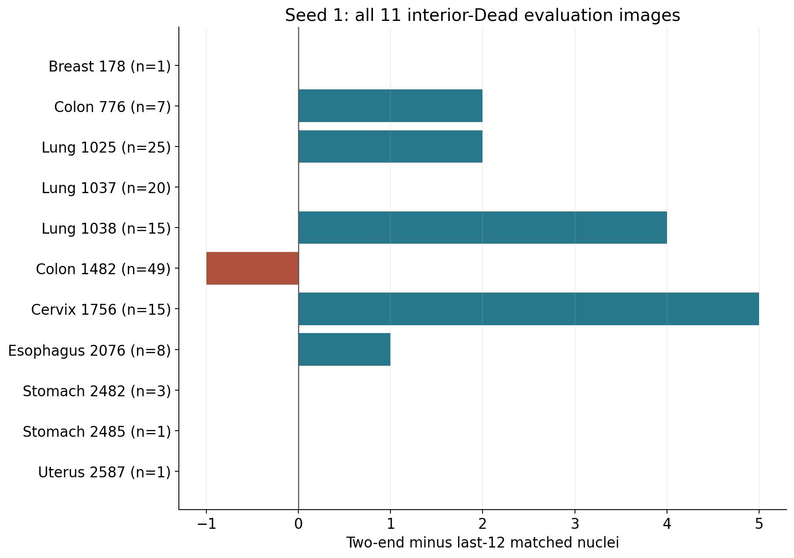

Seed 1 gains on five images, loses one and is unchanged on five. Lung contributes +6, cervix +5, colon +1 and esophagus +1. Lung image 1038 contributes +4 in seed 1 and +5 in seed 19. Cervix 1756 contributes +5/+2. Colon 1482 instead changes 11/49→10/49 in seed 1 and 13/49→13/49 in seed 19: 39/36 target objects remain missed in this concentrated image. Lung 1025 reverses direction between seeds, −2/+2. Both seeds improve in the aggregate, but their gains are distributed differently. Removing any single positive image leaves gains of 6.15–14.58 percentage points in seed 1, alongside 8.03–16.67 in seed 19.

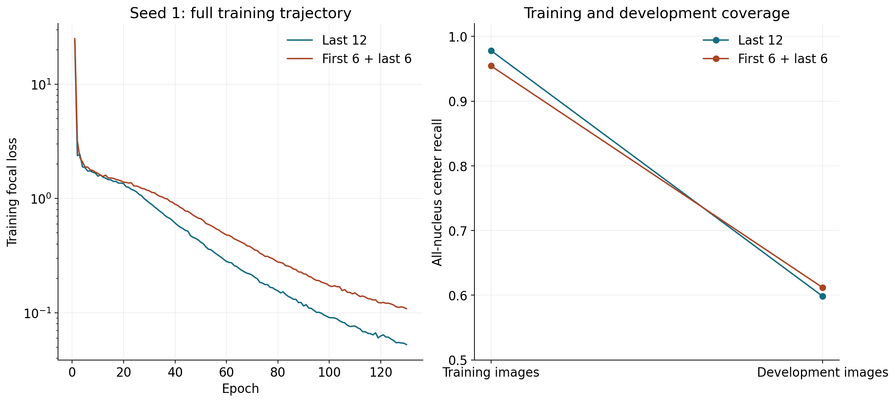

Training recall falls from 97.80% to 95.43%, and training Dead matches from 624/656 to 606/656. Recorded training time is 4.0143 versus 6.7220 hours; checkpoint time is 238.77 versus 2,116.75 seconds. The seed-1 intervention was exposed to prolonged Lustre delays, and its application completion time is 10.1409 hours. These elapsed timings include stalls and provide a resource record, while the seed-19 21.24% training increase is the cleaner same-round cost comparison. GPU peaks are the same across seeds: about 4.05 versus 4.84 GiB.

## Fixed objects that replicate, reverse or exchange across seeds

The fixed eight images in seed 1 retain 29 objects, gain 7, lose 3 and miss 14 in both arms, for net +4 out of 53. Together with seed 19's retained 30, gained 6, lost 4 and jointly missed 13, they expose local changes behind the aggregate improvement.

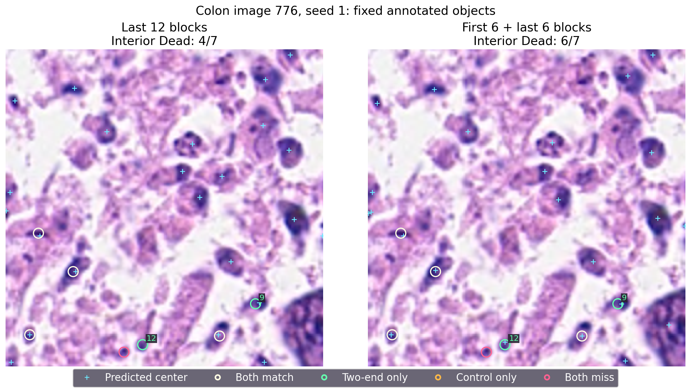

Colon 776 improves 4/7→6/7. Object 12 at (238,110), area 104, is recovered in both seeds: its nearest prediction moves 61.52→2.00 pixels in seed 1 and 80.66→1.00 in seed 19. This shared recovery provides a concrete repeatable example at the same annotation. Seed 1 also gains object 9 at (205,201), area 191, as its distance crosses 3.16→3.00 pixels. Seed 19 instead gains objects 10 and 11 in the lower strip, demonstrating that the same total benefit can involve different nuclei.

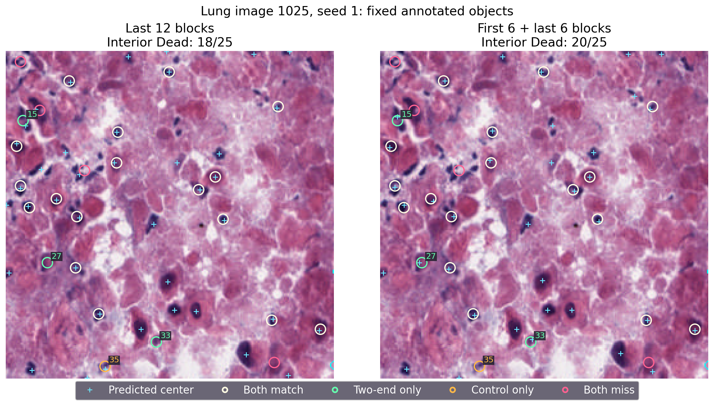

Lung 1025 improves 18/25→20/25 in seed 1. Objects 15 (54,13), 27 (165,32) and 33 (227,117) are gained, with distances 4.47→3.00, 22.36→2.00 and 15.62→2.24 pixels. Object 33 has area 52, placing it in the predefined small-object subset. Object 35 (246,77), area 68, is lost in both seeds: 2.00→18.36 in seed 1 and 1.00→18.36 in seed 19. That repeated loss coexists with the positive tissue-level aggregate.

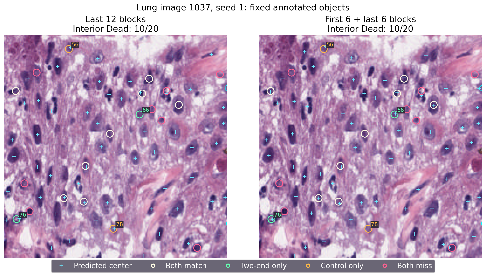

Lung 1037 stays at 10/20 in seed 1, exchanging two gains and two losses. Objects 66 (91,155) and 76 (211,14) gain predictions at distances 19.92→1.41 and 3.16→1.00; objects 56 (16,74) and 78 (222,125) lose matches at 2.83→3.61 and 1.00→22.83. Object 56 crosses the identical boundary in both seeds. An unchanged image count can therefore conceal repeated localization loss plus compensating recovery elsewhere. All object distances, original centers and one-to-one assignments are included in the CSV and raw coordinate JSONs.

## Research and preservation decisions

The next fixed experiment isolates the middle twelve blocks, filling the remaining contiguous update-position comparison. It retains the 151,179,264 trainable encoder parameters, 3,294,657 head parameters, original rates, 130 epochs, seeds, cohort and decision rule. Its hardware checks must demonstrate that data gradients reach middle blocks through the frozen suffix and that the frozen blocks remain unchanged. This is an adaptive development experiment with results to be reported regardless of outcome.

The combined scientific collection verifies 92 small payloads, including 48 final PNGs, against their collected SHA256 values. The 505 source-file verification is inherited from the verified seed-19 collection. Seed-19 and control seed-1 payloads match original preservation records. Experimental seed 1 timed out during preservation after model completion. CPU recovery job 55745860 completed in 185 seconds and preserved all 23 run files, including both checkpoints and 12 final PNGs, with source hashes and independent target readback. All 21 small files match the earlier collection. Six other checkpoint sizes match original records; independent rehashing of those six and external archival remain outstanding. [Preservation recovery](P29_PRESERVATION_RECOVERY.json) records the verified checkpoint hashes. [Machine-readable analysis](p29_verified_analysis.json), [object changes](object_summary.json), [stage pair table](stage_pairs.csv), and [collection verification](collection_result.json) accompany the report. Both seed-level original decisions are false. Close this fixed first-six plus last-six recipe under the original rule. Its paired gains motivate the separately frozen middle-twelve development comparison.
