# 编码器更新位置与细胞核中心检测：P20–P29 阶段分析

P29 在原有十二层更新预算下，种子 19/1 分别多找到 16/13 个内部 Dead 类细胞核，总匹配增加 283/165，未匹配预测减少 65/64。两个配对图像重采样区间均为正，最终召回和精度仍低于原定绝对要求。四个模型均已完成 130 轮训练和开发评估，最后一项调度作业在保存阶段达到时间上限，此前训练、最后检查点重载、开发评估与结果图片均已完成。结合本阶段各轮结果，改变编码器的更新范围，比已测试的额外类别监督、参数平均和预训练参数约束更稳定地改善了部分检测结果，但效果随层位置和组织图像而变化。

## 数据角色与指标

每轮都从相同 UNI 预训练权重重新训练对照和实验模型，使用 PanNuke 第 1 折中的 2,134 张训练图像，并在同折预先留出的 522 张开发评估图像上评估第 130 轮检查点。总体召回以 12,250 个标注核为分母；精度以全部输出中心点为分母，包含未匹配预测。中心点与标注采用三原始像素半径的一对一匹配。模型输出一张不含类别标签的中心图，类别用于统计分层。

“内部 Dead”指 PanNuke 的凋亡或坏死核类别中，标注轮廓不接触图像边界的对象，共 11 张图像、145 个核；其中原始面积小于 67 像素的对象有 32 个。各轮保留种子 19/1、数据划分、解码规则、最后检查点和阈值。后续方案反复使用同一开发评估集，表中的变化均来自同轮新训练对照。实例分割的官方 PQ 和三划分评估另有独立协议。

下一轮 P30 在完整 P29 种子 1 结果出现前冻结，依据 P20–P28 的证据和 P29 的运行进度，比较中间十二层与最后十二层。P29 沿原作业继续运行。P30 的验收与正式提交见 [P30_SUBMISSION.md](P30_SUBMISSION.md)。

## 本阶段十项比较的研究意义

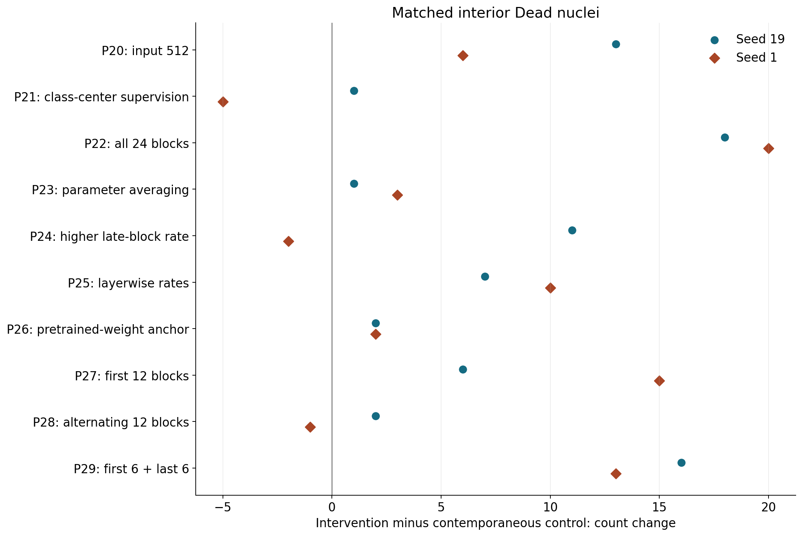

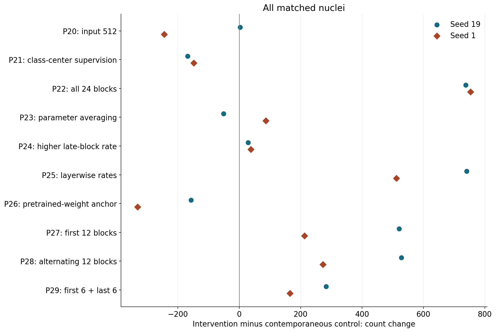

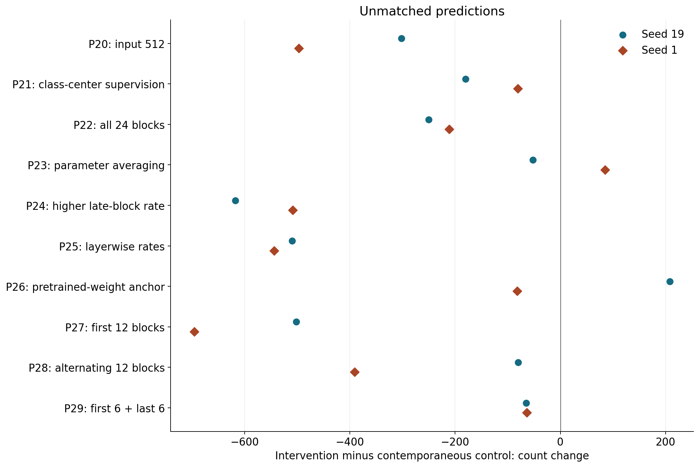

| 测试变化 | 内部 Dead 匹配，种子 19 / 1 | 总匹配 | 未匹配预测 |
|---|---:|---:|---:|
| 输入扩大至 512，P20 | +13 / +6 | +3 / −244 | −302 / −497 |
| 增加类别中心监督，P21 | +1 / −5 | −168 / −148 | −180 / −81 |
| 更新全部 24 层，P22 | +18 / +20 | +738 / +753 | −250 / −211 |
| 参数平均，P23 | +1 / +3 | −51 / +87 | −52 / +85 |
| 提高后十二层学习率，P24 | +11 / −2 | +29 / +38 | −618 / −509 |
| 全层分层学习率，P25 | +7 / +10 | +741 / +512 | −510 / −544 |
| 预训练参数约束，P26 | +2 / +2 | −157 / −331 | +208 / −82 |
| 更新前十二层，P27 | +6 / +15 | +521 / +213 | −502 / −696 |
| 更新交错十二层，P28 | +2 / −1 | +528 / +273 | −80 / −391 |
| 更新前六层和后六层，P29 | +16 / +13 | +283 / +165 | −65 / −64 |

P20 通过更大的输入找回更多 Dead 核，但总体覆盖变化不一致，训练时间约为对照的 4.3 倍。它显示分辨率能影响目标对象的可检测性，同时带来明显成本。P21 使预测和真匹配一起减少，额外类别中心监督在这一固定损失下未改善稀有核的迁移。P23 的参数平均只改变少量 Dead 匹配，总体覆盖方向不一致。P24 删除了许多未匹配点，提高精度，但 Dead 改善在两个种子中反向。上述结果说明，减少预测和找回漏检是不同的研究目标。

P22 是本阶段最稳定的稀有类改善：多匹配 18/20 个内部 Dead 核和 738/753 个总核，同时减少额外点。其最终 Dead 召回为 58.62%/56.55%，精度为 72.84%/73.36%，完整编码器适配改善了当前开发检测，但仍未达到原定绝对条件。P25 也提高总体覆盖与精度，不过 Dead 只增加 7/10 个，而且肺组织增加 9/8 个、结肠减少 7/6 个。总体匹配变好，并未使目标类别在不同组织中一致改善。

P26 将参数约束在预训练值附近，总匹配减少 157/331，Dead 各增加两个，未复现全层更新的改善。P27 在与后十二层对照相同的可训练参数量下，增加 6/15 个 Dead 匹配、减少 502/696 个未匹配点，训练召回却降至 88.80%/87.82%。P28 把更新分散到交错层，训练召回恢复到约 96.3%，Dead 改善则减弱为 +2/−1。P29 种子 19 的训练召回为 95.47%，Dead 增加 16 个。更新位置因此是有实验依据的研究变量；训练集覆盖、参数量和更新层的分散程度都只能解释部分现象，表征机制仍需直接测量。

## P29 种子 19 的覆盖、精度与成本

| 更新范围 | 内部 Dead | 小 Dead | 全部匹配 | 总召回 | 精度 | 未匹配预测 |
|---|---:|---:|---:|---:|---:|---:|
| 最后十二层 | 65/145 | 7/32 | 7,257/12,250 | 59.24% | 69.73% | 3,150 |
| 前六层＋后六层 | 81/145 | 11/32 | 7,540/12,250 | 61.55% | 70.96% | 3,085 |

实验模型多输出 218 个点，却多匹配 283 个核，预测的有效性有所提高。内部 Dead 召回增加 11.0345 个百分点，原固定 1,000 次按组织分层的图像重采样区间为 ［+3.0457，+27.9570］个百分点；总召回增加 2.3102 个百分点、精度增加 1.2328 个百分点。原种子级完整条件中，绝对 Dead 召回 0.60 和精度 0.75 两项未满足，其余种子 19 条件均满足。种子 1 的内部 Dead 召回改善为 8.9655 个百分点，同样未满足两项绝对条件。

训练集总体召回从 97.51% 降至 95.47%，训练内部 Dead 覆盖从 630/656 降至 607/656。纯训练时间为 4.0130/4.8652 小时，实验模型增加约 21.24%；峰值已分配显存约为 4.05/4.84 GiB。种子 19 两项调度总耗时分别为 4:13:24 和 5:00:21，包含启动、评估和保存。训练覆盖、开发检测和调度成本分别回答不同的问题。

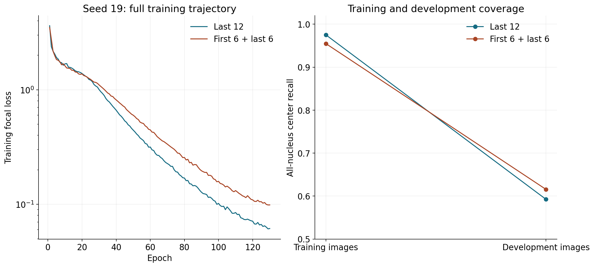

## 哪些组织图像贡献了改善

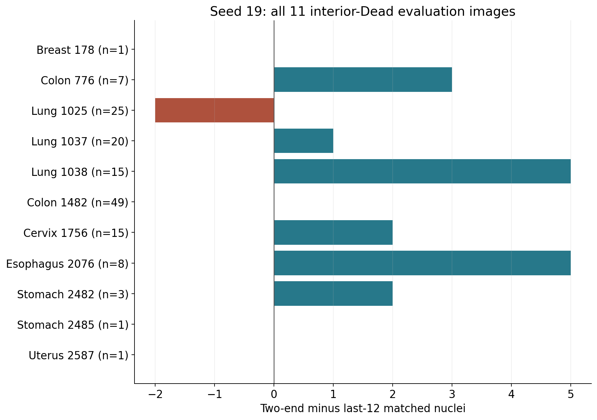

六张图像增加匹配，一张减少，四张不变。肺组织净增加 4 个，结肠 3 个，宫颈 2 个，食管 5 个，胃 2 个；乳腺和子宫不变。肺组织图像 1038 和食管图像 2076 各增加 5 个，合计贡献 16 个净增量中的 10 个。肺组织图像 1025 则减少两个。结肠图像 1482 含 49/145 个目标对象，两臂均只匹配 13 个，该图仍有 36 个目标核未匹配。

逐一去掉一张 Dead 阳性图像作敏感性分析后，召回改善范围为 8.03%–16.67%，均为正。种子 19 的改善符号因此不依赖单张图像。正式原判定仍包含全部十一张图像。只有一张阳性图像的组织，提供的组织内跨图像一致性证据有限。

## 固定样例中的逐核变化

预先固定的八张评估样例包含 53 个内部 Dead 核。种子 19 中，两臂共同找到 30 个，实验模型新增 6 个、丢失 4 个，共同漏检 13 个，净增两个；完整 522 张评估图像的净增量为 16。对象编号和行、列坐标保存在 [fixed_objects.csv](fixed_objects.csv)。青色十字是预测点；白、绿、橙、粉色圆圈依次表示共同找到、新增、丢失和共同漏检。

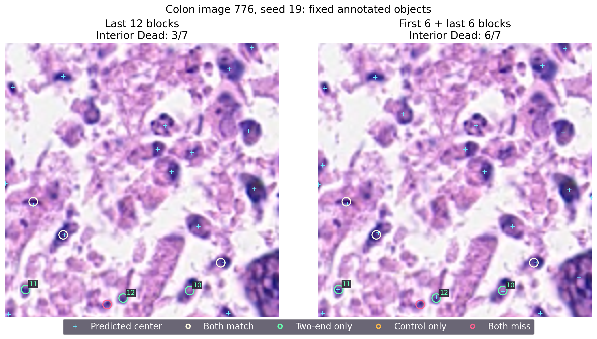

结肠图像 776 的目标匹配从 3/7 升至 6/7。下方组织带中的对象 10 位于（231，172），对象 11 位于（230，19），对象 12 位于（238，110）；最近预测点距离分别从 41.23、28.02 和 80.66 像素降至 1.00 像素。右图在三个标注附近均出现预测，左图相应邻域缺少输出。这些核的可见大小和染色深浅不同，对象 12 面积为 104 像素，恢复对象覆盖了预定义最小面积组以外的核。

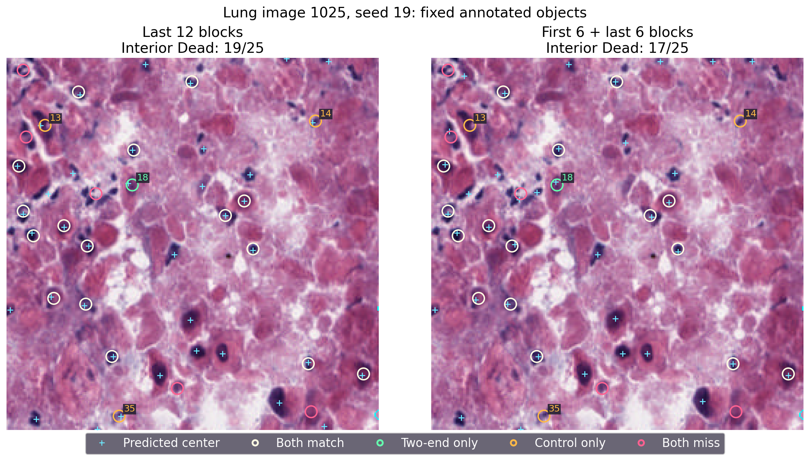

肺组织图像 1025 从 19/25 降至 17/25。对象 18（87，86）的最近预测距离从 3.16 降至 2.24 像素，进入三像素匹配范围。对象 13（46，26）、对象 14（43，212）、对象 35（246，77）丢失匹配，距离分别从 3.00→14.56、2.24→41.77 和 1.00→18.36 像素。对象 14 面积仅 31 像素，视觉上也很小。实验模型在恢复一个对象的同时，失去了多个标注附近的有效输出；组织总量会掩盖这种交换。

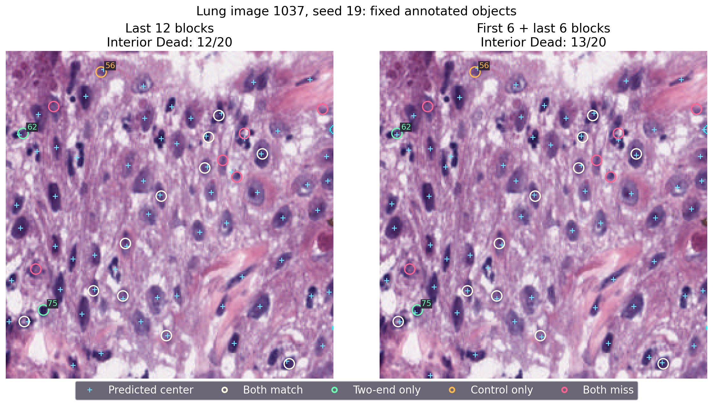

图像 1037 从 12/20 升至 13/20。对象 62（64，13）的距离从 3.16 降至 1.00 像素；面积 44 像素的对象 75（202，29）从 15.00 降至 2.83 像素，附近新增预测。对象 56（16，74）则因最近点从 2.83 移至 3.61 像素而失去匹配。前者表现为原来未覆盖邻域出现输出，后者表现为附近预测跨越固定匹配半径。

坐标记录确定了输出点的出现、消失和位移，原图提供染色、形态和组织环境。要把变化归因于中心分数、峰值抑制或编码器隐层，需要保存概率图或开展中间表征测量。本轮回收包含原图、标注中心、解码点和一对一匹配。

## 种子 1：哪些改善在两个种子中一致

| 种子 1 更新范围 | 内部 Dead | 小 Dead | 全部匹配 | 总召回 | 精度 | 未匹配预测 |
|---|---:|---:|---:|---:|---:|---:|
| 最后十二层 | 67/145 | 7/32 | 7,329/12,250 | 59.83% | 69.25% | 3,255 |
| 前六层＋后六层 | 80/145 | 11/32 | 7,494/12,250 | 61.18% | 70.14% | 3,191 |

种子 1 多找到 13 个目标核，内部 Dead 召回增加 8.9655 个百分点，原固定重采样的 95% 区间为［+3.1250，+20.4082］个百分点。实验模型多输出 101 个点、多匹配 165 个核。两个种子的总体召回、精度和小 Dead 覆盖均改善，训练集覆盖均下降；最终 Dead 召回和精度均未达到 0.60/0.75，原双种子完整条件为 false。两种子配对变化的描述性均值为 Dead 召回 +10.0 个百分点、总体召回 +1.83 个百分点、精度 +1.06 个百分点。两个种子使用相同图像，均值汇总重复训练结果，图像样本量保持原来的 522 张。

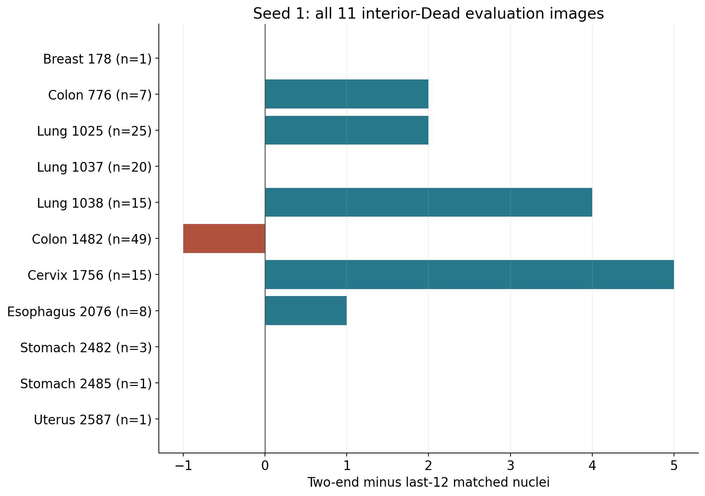

种子 1 有五张图像增加、一张减少、五张不变。肺组织贡献 +6，宫颈 +5，结肠 +1，食管 +1。肺组织图像 1038 在种子 19/1 中分别增加 5/4 个；宫颈图像 1756 增加 2/5 个。结肠图像 1482 则分别为 13/49→13/49 和 11/49→10/49，仍遗漏 36/39 个目标核。肺组织图像 1025 在两个种子中的净变化为 −2/+2。总体改善同方向，贡献图像与具体对象却有差异。种子 1 逐一去掉一张阳性图像后，改善仍为 +6.15～+14.58 个百分点；种子 19 为 +8.03～+16.67 个百分点。

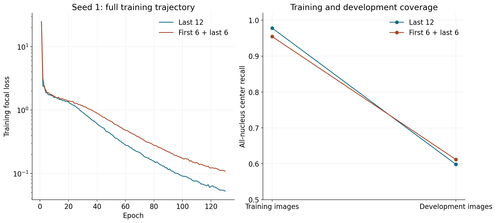

训练集总体召回从 97.80% 降至 95.43%，内部 Dead 匹配从 624/656 降至 606/656。记录的训练时间为 4.0143/6.7220 小时，检查点写入时间为 238.77/2,116.75 秒，实验模型完成训练和评估的应用总耗时为 10.1409 小时。种子 1 实验模型经历了长时间 Lustre 延迟，这些耗时包含等待，用于记录实际资源成本；种子 19 的 21.24% 训练时间增加更适合描述本轮更新范围的常规成本差异。两种子的训练峰值已分配显存均约为 4.05/4.84 GiB。

## 固定对象：重复恢复、重复丢失与相互抵消

种子 1 的八张固定样例共同找到 29 个、新增 7 个、丢失 3 个、共同漏检 14 个，53 个目标对象净增加 4 个；种子 19 分别为 30、6、4、13，净增加 2 个。以下分析沿用相同标注编号和原始坐标。

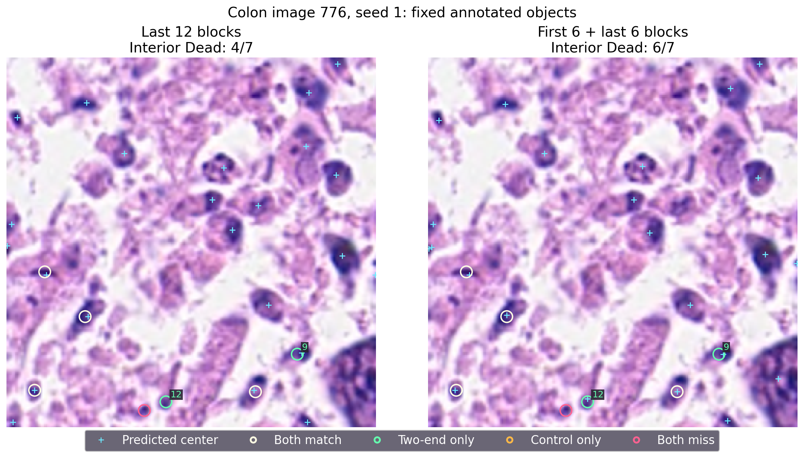

结肠图像 776 从 4/7 增至 6/7。对象 12 位于（238，110），面积为 104 像素，在两个种子中均被找回：最近点距离在种子 19 为 80.66→1.00，种子 1 为 61.52→2.00 像素。这是在同一个标注上重复观察到的恢复。种子 1 还找回对象 9（205，201），面积 191，距离从 3.16 降至 3.00 像素；种子 19 则找回下方组织带中的对象 10 和 11。相似的图像总改善可以来自不同细胞核。

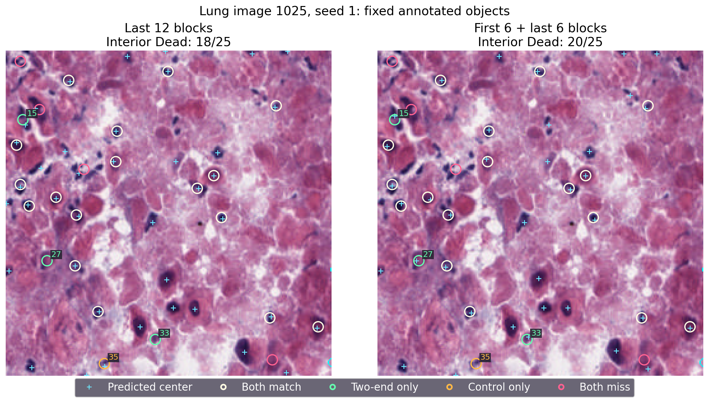

图像 1025 从 18/25 增至 20/25。对象 15（54，13）、27（165，32）、33（227，117）新增匹配，距离分别为 4.47→3.00、22.36→2.00、15.62→2.24 像素。对象 33 面积 52，属于预定义的小核组。对象 35（246，77）面积 68，在两个种子中均丢失：种子 19 为 1.00→18.36，种子 1 为 2.00→18.36 像素。重复出现的局部丢失与肺组织总量的改善同时存在。

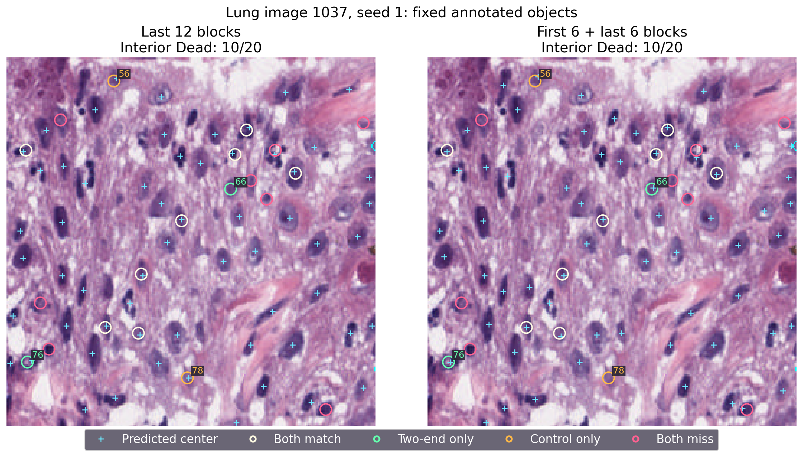

图像 1037 保持 10/20，但内部发生两个新增和两个丢失。对象 66（91，155）、76（211，14）距离为 19.92→1.41 和 3.16→1.00；对象 56（16，74）、78（222，125）距离为 2.83→3.61 和 1.00→22.83 像素。对象 56 在两个种子中跨越了完全相同的匹配边界。因此，图像匹配数不变也可能包含重复的定位丢失，以及其他核的补偿恢复。全部逐核距离、预测中心和一对一分配均保存在坐标 JSON 与 CSV 中。

## 下一轮与保存记录

P30 固定更新中间十二层，补齐连续层位置比较，保留 151,179,264 个编码器可训练参数、3,294,657 个检测头参数、原学习率、130 轮、种子、数据和判定。GPU 验收需证明梯度能通过冻结的后续层到达中间层，并且冻结参数保持不变。它属于适应性的开发实验，结果将按原规则完整报告。

合并后的科学结果包记录并核验了 92 个小产物的 SHA256，其中含 48 张最终 PNG；505 个源码文件的校验沿用此前已核验的种子 19 回收。种子 19 和对照种子 1 的小产物也与原保存清单相符；实验种子 1 在模型评估结束后从 scratch 回收，之后调度作业在保存阶段超时，原保存清单尚未回收。六个检查点大小与原清单相符，另两个实验种子 1 检查点仅记录当前大小。大检查点独立重哈希及外部归档仍待安排。[完整数值分析](p29_verified_analysis.json)、[对象变化](object_summary.json)、[阶段成对表](stage_pairs.csv) 和 [回收核验](collection_result.json) 随报告保存。原双种子完整条件均未通过，按原规则关闭这一前六层加后六层设置；其一致的配对改善为已独立冻结的中间十二层比较提供了研究依据。
